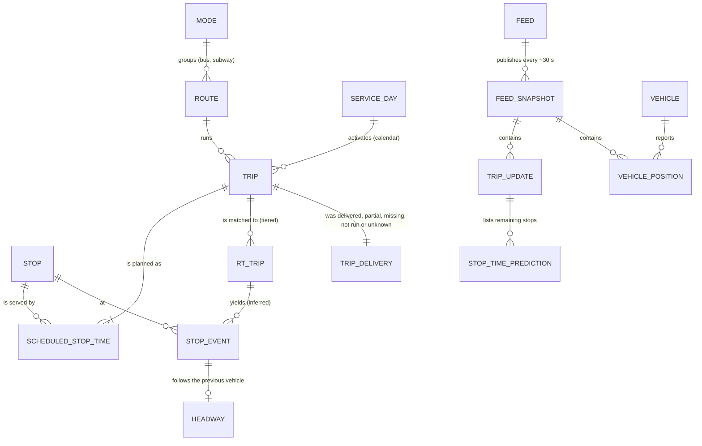

# Data model

The data model at three levels: the conceptual model of the transit domain, the logical tables of each layer, and their physical design. The last section reads the Gold layer as a data warehouse. Table names, columns and keys come from the code (`src/transitometer/pipeline/`, `src/transitometer/golden/sql/`) and from the declared golden keys (`golden/tolerance.json`); row counts are those of the golden window (service days 22–23 September 2026).

## 1. Conceptual model

Two sources describe the same service and never meet on their own: the **static schedule** (GTFS) says what should happen, and the **real-time feeds** (GTFS-Realtime) report snapshots of what is happening. Neither says "the bus arrived at this stop". The central entity, the **stop event**, is inferred by the pipeline; every KPI is built on it.

| Entity | Identified by | Source |
|---|---|---|
| Route, trip, stop, scheduled stop time, service day | `route_id`; `static_trip_id`; `stop_id`; (trip, `stop_sequence`); `service_date` | GTFS static (versioned per agency) |
| Feed snapshot | (`feed`, `source_file`, `feed_timestamp`) | GTFS-RT archive, one Parquet row group per snapshot |
| Trip update, stop-time prediction | (`trip_id`, snapshot), (`trip_id`, `stop_id`, snapshot) | trip-updates feeds (bus, subway) |
| Vehicle position | (`vehicle_id`, `timestamp`) | bus vehicle-positions feed |
| Real-time trip | (`trip_id`, `unit`); `unit` = vehicle for buses, the trip itself for the subway | matching step |
| **Stop event** | (`grp`, `service_date`, `static_trip_id`, `stop_id`) | inferred: the last prediction before the stop leaves the trip's list |
| Headway | (`grp`, `service_date`, `route_id`, `stop_id`, `trip_key`) | consecutive stop events at a stop |
| Trip delivery | (`grp`, `service_date`, `trip_id`) | scheduled trips vs observed events and feed coverage |

## 2. Logical model, layer by layer

**Landing (bronze)**: 94 Parquet files, 12.31 GB, each with its SHA-256 in `data-manifest.json`. The archive is the system of record; nothing downstream edits it.

**Kafka**: one topic per feed, `<prefix>.<feed>` (`trip_updates.bus`, `trip_updates.subway`, `vehicle_positions.bus`). One message per entity: the protobuf `FeedEntity`, keyed by `trip_id` or `vehicle_id`, with the headers `feed`, `feed_timestamp`, `fetch_timestamp_us` and `source_file`. A marker topic per feed, `<prefix>.snapshots.<feed>`, carries one JSON record per snapshot for counts and lineage.

**Silver, ingest** (`pipeline/silver_ingest.py`; Spark Structured Streaming from Kafka to Delta):

| Table | Grain | Main columns |
|---|---|---|
| `trip_update_rows` | one stop-time prediction of one entity in one snapshot | snapshot (`feed`, `source_file`, `feed_timestamp`, `fetch_timestamp_us`, `feed_date`), entity and trip fields, stop fields (`stop_sequence`, `stop_id`, arrival and departure time and delay), lineage (`kafka_partition`, `kafka_offset`) |
| `vehicle_positions` | one vehicle in one snapshot | snapshot, trip, vehicle, position (latitude, longitude, bearing, speed), `timestamp`, lineage |
| `feed_snapshots` | one snapshot | the marker record: `feed`, `source_file`, `feed_timestamp`, `fetch_timestamp_us`, `entities`, `rows` |
| `dead_letter` | one rejected message | Kafka coordinates, key, headers, `invalid_reason`, the raw payload, `ingest_date` |

Duplicates are dropped on (`message_key`, `source_file`, `payload_sha256`) within the watermark. The ingest is checked by conservation: every message read is kept, dropped as a duplicate or as late, or dead-lettered.

**Silver, events** (`pipeline/silver_events.py`; the same rules as golden steps 01–04):

| Table | Key | Rows | Role |
|---|---|---|---|
| `scheduled_stops` | (trip, stop sequence) | | timetable of the active service days |
| `matched_trips` | (`grp`, `service_date`, `trip_id`) | | real-time trip ↔ static trip, with the matching tier |
| `stop_events` | (`grp`, `service_date`, `static_trip_id`, `stop_id`) | 2,955,606 | `sched_arrival`, `observed_arrival`, `delay_s`, `service_hour`, `status` (passed, terminal, unconfirmed, implausible, stale), `observations` |

**Gold** (`pipeline/gold_kpis.py`; 23 tables, each equal to golden). The fact tables, by grain:

| Table | Key (= declared golden key) | Rows | Requirement |
|---|---|---|---|
| `headways` | `grp`, `service_date`, `route_id`, `stop_id`, `trip_key` | 2,956,930 | BR2 |
| `segments` | `grp`, `service_date`, `static_trip_id`, `unit`, `to_stop` | 2,845,556 | BR4 |
| `stop_hour_reliability` | `grp`, `route_id`, `direction_id`, `stop_id`, `service_hour` | 392,788 | BR8 |
| `segment_travel_stats` | `grp`, `route_id`, `direction_id`, `from_stop`, `to_stop`, `service_hour` | 380,506 | BR4 |
| `trip_delivery` | `grp`, `service_date`, `trip_id` | 117,076 | BR3 |
| `trip_delay_attribution` | `grp`, `service_date`, `static_trip_id`, `unit` | 110,050 | BR4 |
| `warning_decisions` | `grp`, `service_date`, `static_trip_id`, `unit` | 105,488 | BR6 |
| `terminal_events` | `grp`, `service_date`, `static_trip_id` | 73,874 | BR3 (bus terminals) |
| `otp_route_hour` | `grp`, `service_date`, `route_id`, `service_hour` | 14,476 | BR1 |
| `headway_regularity` | `grp`, `service_date`, `route_id`, `service_hour` | 13,891 | BR2 |
| `route_hour_scorecard` | `grp`, `route_id`, `service_hour` | 7,275 | BR5 |
| `position_jumps` | `vehicle_id`, `ts` | 5,377 | BR7 |
| `missing_by_route` | `grp`, `service_date`, `route_id` | 708 | BR3 |
| `route_scorecard` | `grp`, `route_id` | 353 | BR5 |
| `feed_quality_metrics`, `feed_quality_score` | `feed`, `day` (, `metric`) | 46, 6 | BR7 |
| `otp_summary`, `headway_summary`, `missing_trip_summary`, `delay_attribution_summary`, `early_warning_summary`, `delay_sanity_summary`, `terminal_summary` | `grp`, `service_date` (+ scope, outcome, method) | ≤ 16 each | BR1–BR6 summaries |

## 3. Physical design

| Layer | Storage | Physical choices | Why |
|---|---|---|---|
| Landing | Parquet on the host data root (read-only mount into the containers) | one row group per feed snapshot; SHA-256 per file | replay reads one snapshot at a time; integrity is checkable |
| Kafka | KRaft broker, `kafka-data` volume | 6 partitions per topic; key `trip_id` / `vehicle_id` (murmur2), so one entity stays in order on one partition; zstd; idempotent producer, `acks=all`; unlimited retention for replay topics, 64 MB segments; `LogAppendTime` stamps | identical offsets for every engine; per-key order; measurable latency |
| Silver ingest | Delta Lake (`lakehouse` volume), zstd Parquet | partitioned by `feed_date`; streaming checkpoints in the `checkpoints` volume with 2 retained batches | append-only, exactly-once into Delta per checkpoint; bounded state |
| Silver events | Delta Lake | `stop_events` and the other event tables partitioned by `service_date`; batch overwrite per run | queries filter by service day; a run rebuilds the window |
| Gold | Delta Lake | batch overwrite, not partitioned (the largest table has 2.96 M rows) | small tables; partitioning would only add files |
| Axis B copy | Delta, `lakehouse/axis_b` | one service day per Delta version (version 0 = first day) | time-travel queries q24/q25 |
| Golden reference | DuckDB over the landing Parquet, outputs as Parquet with checksums | 12 SQL steps, 8 threads; every ordering is total (for example `arg_max` with a tie-breaker) | independent check; reruns are byte-identical |
| ClickHouse (Axis B) | `MergeTree`, one table per suite table | `ORDER BY` the table's golden key; columns never NULL declared non-Nullable | sorted primary index on the query keys |

## 4. Gold as a data warehouse

The Gold layer is a small dimensional warehouse whose dimensions are columns of the fact tables (the static GTFS supplies their attributes, such as route names and stop names and locations, in `stop_names` and `stop_locations`).

- **Dimensions**: mode (`grp`: bus, subway), service day (`service_date`), route (`route_id`, `direction_id`), stop (`stop_id`), hour of service (`service_hour`, which runs past 23 for trips after midnight), feed (`feed`).
- **Grain**: each fact table states its grain through its key (section 2). The atomic facts are `stop_events` (one arrival), `headways` (one gap between consecutive vehicles at a stop), `segments` (one trip between consecutive stops) and `trip_delivery` (one scheduled trip). The other tables are aggregates of these at coarser grains: route-hour, route, stop-hour, service day.
- **Measures**: counts (`events`, `on_time`, `late`, `early`, `bunched`, `gaps`, `scheduled`, `delivered`, `missing`) are additive along every dimension. Shares, medians, percentiles and confidence intervals are not: rolling up a share means recomputing it from the summed counts, and percentiles must be recomputed from the atomic facts. The app follows this rule; it never averages shares.
- **Time**: two times are kept apart. Event time is the observed arrival, which decides the service day and hour; load time is the feed and fetch timestamp, kept with every Silver row for lineage. Late data is handled on event time (watermark), so a late snapshot still lands in the right service day.
- **A time-variant timetable**: which trips run on a day is decided per `service_date` from the calendar's validity range (`start_date` to `end_date`) and its exceptions (`calendar_dates`: added or removed services). The static schedule itself is published in versions; the golden window falls inside one bus and one subway version, so a single version is in effect. Over a longer history the timetable would become a type-2 slowly changing dimension keyed by its validity dates.

## 5. Data models used, relational to non-relational

| Model | Where | What it gives the project |
|---|---|---|
| Relational, normalised | GTFS static (routes, trips, stops, stop_times, calendar) | the timetable and its keys |
| Hierarchical messages | GTFS-RT protobuf (`FeedMessage` → `FeedEntity` → `TripUpdate` → `StopTimeUpdate`) | compact, schema-evolving real-time feeds |
| Append-only log | Kafka topics (key, value, headers, offset, append time) | ordered, replayable input shared by every engine |
| Columnar, versioned tables | Delta Lake on Parquet | ACID appends, time travel, schema enforcement |
| Columnar with a sorted index | ClickHouse `MergeTree` | fast scans on the declared keys |
| Dimensional | Gold facts and dimensions (section 4) | answers per route, stop, hour and day |
